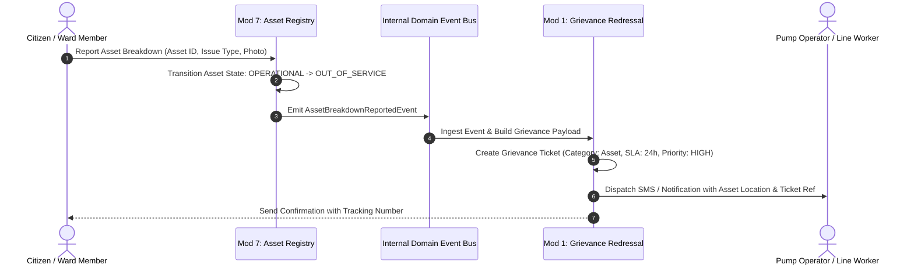
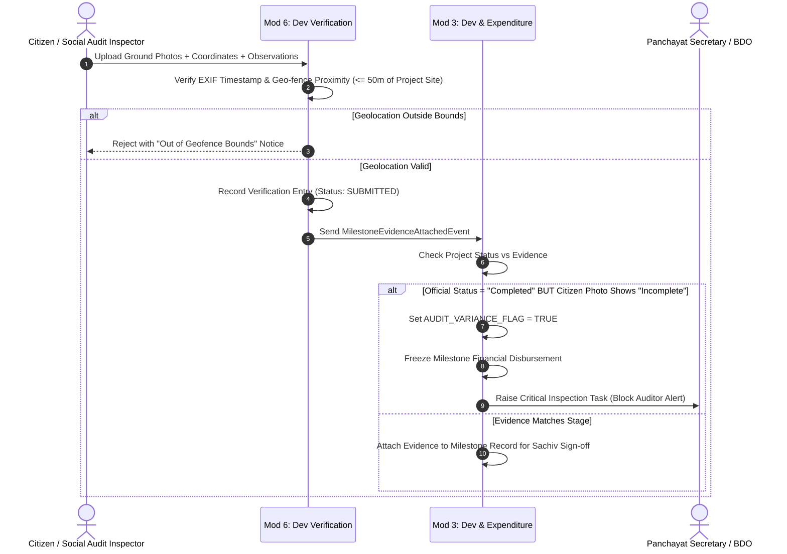
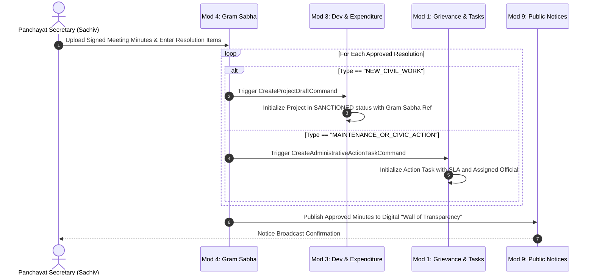
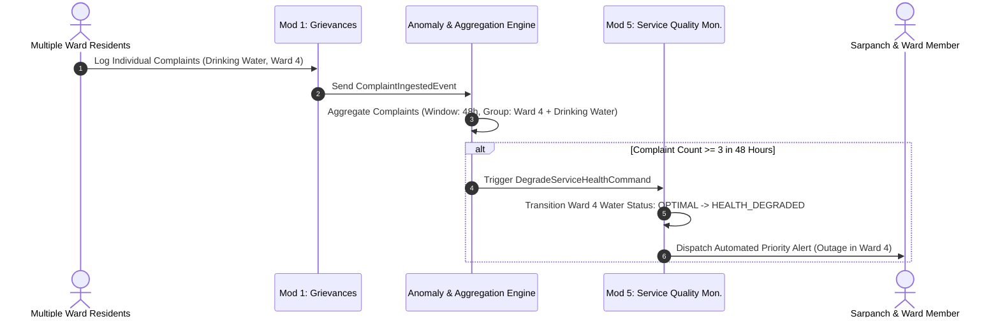
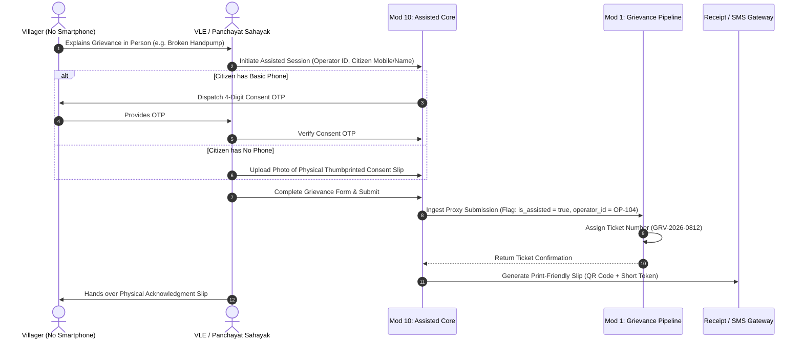

# Gram Vikas — Phase 0: Inter-Module Workflows & Data Flows

**Document Reference:** `docs/phase-0/03_INTER_MODULE_WORKFLOWS.md`  
**Project:** Gram Panchayat – Gram Vikas  
**Phase:** Phase 0 (Domain Modeling & Requirements Engineering)  
**Status:** Approved for Architecture Design  

---

## 1. Overview of Platform Interoperability

The Gram Vikas architecture avoids monolithic silos by establishing explicit, contract-driven events and data handoffs between modules. Every cross-module communication is asynchronous or mediated by a domain service boundary, ensuring that no single module failure cascades to other business capabilities.

---

## 2. Core Cross-Module Workflows

### 2.1 Workflow 1: Infrastructure Asset Damage to Automated Grievance Dispatch
**Source Module:** Module 7 (Infrastructure & Water Asset Monitoring)  
**Destination Module:** Module 1 (Grievance Management)

#### Purpose & Description
When a citizen, ward member, or pump operator records that a public asset (e.g., tube well or water purification plant) has broken down or suffered damage, the system updates the asset condition and automatically generates a high-priority grievance ticket assigned to the designated maintenance technician.

#### Flow Diagram



#### Event Contract / Data Payload
```json
{
  "event_name": "AssetBreakdownReportedEvent",
  "timestamp": "2026-11-26T10:30:00Z",
  "payload": {
    "asset_id": "AST-W3-BW-012",
    "asset_type": "BOREWELL",
    "panchayat_id": "GP-IND-MH-0042",
    "ward_id": "WARD-03",
    "reported_by_user_id": "USR-CITIZEN-9921",
    "issue_description": "Submersible pump motor burned out; no water supply to 45 households.",
    "geo_coordinates": {
      "latitude": 19.8765,
      "longitude": 75.3421
    },
    "photo_evidence_url": "https://storage.gramvikas.in/evidence/asset-w3-bw-012-fault.jpg",
    "auto_generated_grievance_category": "DRINKING_WATER_ASSET"
  }
}
```

#### Validation & Error Handling
- If `asset_id` already has an active, unresolved grievance in Mod 1 within the last 72 hours, the system suppresses duplicate ticket creation and instead increments the `incident_complaint_counter` on the existing ticket.

---

### 2.2 Workflow 2: Citizen Geo-Evidence to Project Milestone Verification
**Source Module:** Module 6 (Development Verification)  
**Destination Module:** Module 3 (Development & Expenditure Tracking)

#### Purpose & Description
Prevents fraudulent contractor payouts by validating on-ground progress using citizen/inspector geotagged photos before any financial disbursement milestone is marked complete in the expenditure ledger.

#### Flow Diagram



#### Event Contract / Data Payload
```json
{
  "event_name": "MilestoneEvidenceAttachedEvent",
  "timestamp": "2026-11-26T11:15:00Z",
  "payload": {
    "project_id": "PRJ-2026-0042-CCROAD",
    "milestone_id": "MLSTN-02-CONCRETE-LAYER",
    "panchayat_id": "GP-IND-MH-0042",
    "verification_source": "CITIZEN_SOCIAL_AUDIT",
    "geo_coordinates": {
      "latitude": 19.8761,
      "longitude": 75.3418
    },
    "site_proximity_meters": 18.4,
    "photo_urls": [
      "https://storage.gramvikas.in/evidence/prj042-m2-photo1.jpg",
      "https://storage.gramvikas.in/evidence/prj042-m2-photo2.jpg"
    ],
    "citizen_rating": "DEFECTIVE",
    "variance_description": "Road surface cracking within 48 hours of casting; aggregate unmixed."
  }
}
```

---

### 2.3 Workflow 3: Gram Sabha Resolution to Project Initiation / Action Task
**Source Module:** Module 4 (Gram Sabha Participation)  
**Destination Module:** Module 3 (Development & Expenditure) & Module 1 (Grievance)

#### Purpose & Description
Physical Gram Sabha resolutions are officially binding directives under Panchayati Raj law. When the approved minutes are digitized, actionable decisions are automatically converted into Development Project proposals (Mod 3) or direct Administrative Work Tasks (Mod 1).

#### Flow Diagram



#### Event Contract / Data Payload
```json
{
  "event_name": "GramSabhaResolutionApprovedEvent",
  "timestamp": "2026-11-26T14:00:00Z",
  "payload": {
    "gram_sabha_meeting_id": "GS-2026-Q3-001",
    "resolution_number": "RES-03/2026",
    "panchayat_id": "GP-IND-MH-0042",
    "resolution_type": "NEW_CIVIL_WORK",
    "title": "Construction of Concrete Drain in Harijan Basti (Ward 2)",
    "allocated_funding_stream": "15TH_FINANCE_COMMISSION_TIED",
    "estimated_cost": 250000.00,
    "responsible_actor_role": "PANCHAYAT_SECRETARY",
    "target_initiation_date": "2026-12-15"
  }
}
```

---

### 2.4 Workflow 4: Recurring Service Complaints to Quality Degradation Status
**Source Module:** Module 1 (Grievance Redressal)  
**Destination Module:** Module 5 (Service Quality Monitoring)

#### Purpose & Description
Prevents systemic utility failures by correlating individual complaints. If multiple distinct households in the same ward complain about drinking water absence or streetlight blackouts within a 48-hour window, the Ward Service Health state automatically drops to `HEALTH_DEGRADED` or `CRITICAL_OUTAGE`.

#### Flow Diagram



---

### 2.5 Workflow 5: Assisted Digital Access to Citizen Grievance & Scheme Pipeline
**Source Module:** Module 10 (Assisted Digital Access)  
**Destination Module:** Module 1 (Grievance) & Module 2 (Scheme Intelligence)

#### Purpose & Description
Bridges the digital divide for elderly and non-literate villagers. When an operator (VLE / CSC / Panchayat Assistant) creates a grievance or scheme application, the system binds operator identity, captures citizen consent (OTP or physical slip upload), and forwards the payload into the standard citizen pipelines while issuing an immediate offline-friendly tracking receipt.

#### Flow Diagram



---

## 3. Workflow Summary & Cross-Module Dependency Matrix

| Triggering Module | Source Event | Target Module | Resulting Action | SLA / Latency |
| :--- | :--- | :--- | :--- | :--- |
| **Mod 7 (Assets)** | `AssetBreakdownReported` | **Mod 1 (Grievance)** | Auto-generate maintenance ticket | Immediate (< 5s) |
| **Mod 6 (Dev Verification)** | `MilestoneEvidenceAttached` | **Mod 3 (Expenditure)** | Validate milestone / Raise variance flag | Immediate (< 10s) |
| **Mod 4 (Gram Sabha)** | `ResolutionApproved` | **Mod 3 (Expenditure)** | Initialize draft development project | Batch / Next day |
| **Mod 4 (Gram Sabha)** | `ResolutionApproved` | **Mod 1 (Grievance)** | Generate administrative action task | Immediate (< 10s) |
| **Mod 1 (Grievance)** | `ComplaintClusterDetected` | **Mod 5 (Service Quality)** | Degrade ward health indicator to Degraded | Real-time (48h window) |
| **Mod 10 (Assisted)** | `AssistedSubmissionCompleted`| **Mod 1 / Mod 2** | Enqueue into citizen review pipeline | Immediate (< 2s) |
| **Mod 3 (Expenditure)** | `ExpenditureVoucherLogged` | **Mod 9 (Communication)**| Update public Wall of Transparency feed | Hourly sync |
| **Mod 4 (Gram Sabha)** | `MeetingScheduled` | **Mod 9 (Communication)**| Broadcast agenda notice to village feed | Scheduled (7-15 days prior)|

---

## 4. Resilience, Idempotency & Failure Semantics

1. **Idempotency Keys:** Every cross-module submission carries a deterministic client-generated or event-derived UUID (e.g., `ASSET_FAULT_{asset_id}_{date}`) to prevent duplicate ticket generation during retries.
2. **Dead Letter Queue (DLQ) Concept:** If an automated event cannot be delivered (e.g., Mod 1 unavailable during database lock), events are retained in an internal queue and re-attempted with exponential backoff up to 5 times.
3. **Decoupled Monolith Boundaries:** Modules communicate through strongly typed in-memory event dispatchers (in Phase 1), ensuring that zero inter-process network hops or RPC failures occur within the single application process.
